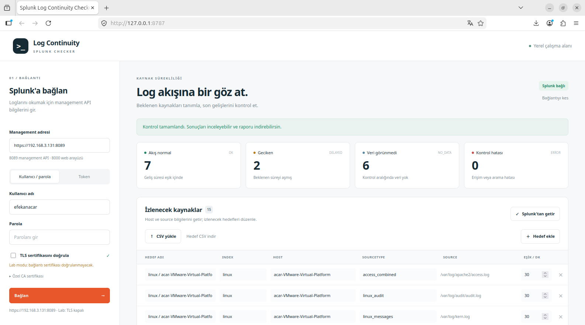

# SIEM Guardian

Python 3.10+ ile çalışan, Splunk Management API'ye bağlanan sade yerel web arayüzü
ve CLI. Beklenen kaynakların yalnız log gönderip göndermediğini değil, **olay türü,
gerekli alan, zaman, hacim ve index yönlendirmesi** kapsamını da kontrol eder.
Sonuçlar terminalde ve CSV raporunda görülebilir. Bağımlılıklar requests,
python-dotenv ve standart kütüphanedir.

## Hızlı başlangıç: Ubuntu

```bash
git clone https://github.com/efekanacar/splunk-log-continuity-checker.git
cd splunk-log-continuity-checker
python3 -m venv .venv
source .venv/bin/activate
python3 -m pip install -r requirements.txt
cp checks.example.json checks.json
python3 webapp.py
```

Tarayıcıda `http://127.0.0.1:8787` adresini açın. Splunk management adresini
(`https://SUNUCU:8089`) ve kullanıcı/parola veya token'ı girin. **Kontrol JSON / CSV
yükle** ile düzenlediğiniz `checks.json` dosyasını seçin; sonra **Sağlık kontrolünü
çalıştır** seçin. CLI için `.env.example` dosyasını `.env` olarak kopyalayıp
kimlik bilgilerini yerel dosyada doldurun ve `python3 healthcheck.py --checks
checks.json --show-spl` çalıştırın. Arayüz, `.env` gerektirmez. `:8000` Splunk Web
portudur; REST için `:8089` management API kullanılır. Management API üzerinden
uygulama bağlantısı bu ortamda doğrulanmadı.

`checks.example.json` tamamen sahte host ve index içerir; canlıda kendi değerlerinizi
girin. Gerçek `checks.json`, `.env` ve `reports/` Git'e eklenmez. Bu ortamda
uygulamanın `:8089` REST bağlantısı/oturum açması doğrulanmadı; Splunk Web Search
ekranında sağlık SPL'si ayrıca denendi.

## Dashboard ve detection bağımlılıkları

Üst kartlarda tanımlı **beklenen kaynak**, **sağlıklı**, **problemli** ve **belirsiz** kaynak sayısı
görünür. Veri gelmeden sağlıklı/problemli sayısı `—` kalır; örnek sonuç canlı sonuç
gibi gösterilmez. Sağlık kontrollerinin altındaki **Detection Dependency Monitoring**
paneli her tespit kuralının log gereksinimlerini açıklar. `detections` listesinde
`mode: "any"` alternatif kaynaklardan en az birinin, `mode: "all"` tüm kaynakların
sağlıklı olmasını ister. Bir alternatif `ERROR` verirse ve diğerleri başarısızsa
sonuç `UNKNOWN` olur; güvenilir veri olmadan etki kesin ilan edilmez. Aralıklı
bir kaynakta `QUIET` da detection sonucunu `UNKNOWN` yapar.

Örnekte `T1059.001 – PowerShell`, Sysmon Event ID 1 **veya** PowerShell 4104
ile desteklenir. İkisi de kaybolursa sonuç `IMPAIRED` ve “PowerShell tespit
kabiliyeti etkilenmiş olabilir” mesajıdır. Yalnız biri kaybolursa diğeri sağlıklı
olduğu sürece `COVERED` görünür. Bu, detection kuralının gerçekten tetiklendiğini
değil, gerekli log kapsamının varlığını ölçer. Sysmon henüz kurulmadıysa gerçek
konfigürasyonda varmış gibi eklemeyin; kurulum sonrası index/host/source'u
doğrulayın.

Beklenen envanter **JSON veya CSV** ile yüklenir: `checks.example.json` detection
bağımlılıklarını da içerir, `checks.example.csv` sade sağlık envanteri örneğidir.
CSV'de `name,kind,index,host,sourcetype,window_minutes` zorunludur; `source`,
`availability`, `activity_check` ve
kural türüne ait alanlar isteğe bağlı sütunlardır. CSV import detection tanımı
taşımaz; detection takibi için JSON kullanın. Eski `targets.csv` kaynak sürekliliği
ekranında da çalışır.

Webhook veya SMTP bildirimi **varsayılan kapalıdır**. CLI'da `.env` içine HTTPS
`GUARDIAN_WEBHOOK_URL` veya SMTP/posta alanlarını girip yalnız açıkça
`python3 healthcheck.py --checks checks.json --notify` çalıştırırsanız sorun
özeti gönderilir. Yalnız `ALERT`, sürekli kaynakta `NO_DATA` ve `IMPAIRED`
bildirilir; `QUIET`, `UNKNOWN`, yetersiz örnek ve arama hatası dışarıya yanlış
arıza uyarısı olarak gönderilmez. Arayüz bildirim göndermez;
webhook/e-posta kimlik bilgileri rapora veya terminale yazılmaz. Aynı komutu tekrar
çalıştırmak aynı sorun için yeni bildirim üretir; periyodik kullanımda alıcı tarafta
tekilleştirme uygulayın.

## Sağlık kontrolleri

| `kind` | Ne ölçer? | Önemli ayarlar |
| --- | --- | --- |
| `presence` | Belirli index/host/sourcetype ve isteğe bağlı source için log varlığı | `window_minutes`, `min_events` |
| `event_id` | Kaynakta belirli olay kimliğinin kaybolması | `event_id_field` (`auto`, `EventCode` veya `EventID`), `event_id`, `min_events` |
| `field` | Detection kuralının ihtiyaç duyduğu alanın dolu olma oranı | `field`, `min_present_percent`, `min_events` |
| `timestamp` | Ham Apache zamanını `_time` ile veya `_time` değerini `_indextime` ile karşılaştırır | `timestamp_source`, `max_parse_diff_seconds` veya `max_age_minutes`/`max_future_minutes`, `max_bad_percent`, `min_events` |
| `volume` | Önceki eşit uzunluktaki aralığa göre log hacmi düşüşü | `drop_percent`, `min_baseline_events` |
| `route` | Aynı host/sourcetype loglarının beklenen index dışına gitmesi | `min_events` |

Bütün kurallarda `name`, `kind`, `index`, `host`, `sourcetype`, `window_minutes`
zorunludur; `source` isteğe bağlıdır ve dosya/kanal bazında kesin eşleşme sağlar.
`availability: "continuous"` varsayılandır. Makine düzenli açık kalmıyorsa
`"intermittent"` seçin: pencerede veri yoksa `QUIET` çıkar. Bu durum sağlıklı
akışın kanıtı da, durmuş kaynağın kanıtı da değildir. İsteğe bağlı
`activity_check`, **aynı hostta** tanımlı başka bir kontrolün adıdır; örneğin
Windows Security akışı `OK` iken Sysmon sessizse sonuç `ALERT` olur. Referans da
sessiz veya hatalıysa Sysmon `QUIET` kalır. İki kontrol için aynı pencereyi
kullanmak anlamlı karşılaştırma sağlar.
`index`, `host`, `sourcetype`, `source` için wildcard kabul edilmez. `event_id`
ve `field` kuralları kendi özel alanlarını da gerektirir. En fazla 50 kural yüklenir.
Hedef alan adlarını **Splunk'tan getir** ile keşfedip JSON'a aktarabilirsiniz;
`EventCode`/`EventID` ve detection alanlarını ayrıca kendi SPL sonuçlarınızla
doğrulayın. `event_id_field: "auto"`, önce `EventCode`/`EventID` arar; Windows XML
olayında ham `<EventID>` etiketini yedek olarak çıkarır. Örnek dosyadaki eşikler
üretim ortamı için varsayılan öneri değildir.

Sağlık durumları: `OK` eşik içinde; `ALERT` beklenen davranış bozulmuş;
`NO_DATA` sürekli beklenen kaynakta kontrol aralığında olay görünmemiş;
`QUIET` aralıklı kaynakta olay görünmemiş; `INSUFFICIENT_BASELINE`
karar için yeterli örnek veya önceki hacim yok; `ERROR` arama/işleme hatası.
`NO_DATA` tek başına kaynağın durduğunu kanıtlamaz. Splunk VM kapalıyken API
erişimi başarısız olur ve sonuç `ERROR` olur; boş arama sonucu gibi gösterilmez.
Her satırda ölçülen değer,
eşik, açıklama, çalıştırılan SPL ve Splunk search job kimliği gösterilir. CLI
`--show-spl` ile sorguları yazdırır; rapor CSV'si `reports/` altında üretilir.

Örnek CLI komutları:

```bash
python3 healthcheck.py --checks checks.json
python3 healthcheck.py --checks checks.json --output reports/health.csv --show-spl
python3 -m unittest discover -s tests -v
```

CLI çıkış kodu `0`: eylem gerektiren sorun yok (`QUIET` ve yetersiz örnek
raporda görünmeye devam eder); `1`: `ALERT`, sürekli kaynakta `NO_DATA` veya
etkilenen detection; `2`: arama/erişim/işleme hatası. `--notify` yalnız eylem
gerektiren sonuçları gönderir.

Hacim karşılaştırması yalnız bir önceki eşit aralığı kullanır; mesai saati ve
haftalık döngü için eşikleri siz belirlemelisiniz. Apache combined access log için
`timestamp_source: "apache_combined"`, `[08/Oct/2026:20:15:11 +0300]` biçimindeki
ham zamanı timezone ile yeniden ayrıştırıp `_time` ile karşılaştırır. Bu örnek
**17:15:11 UTC**'dir. Ayrıştırılamayan veya toleransı aşan olaylar bozuk sayılır.
Diğer biçimler için varsayılan `index_gap`, `_time`–`_indextime` farkına bakar;
tek başına parse hatası ile geç ulaşan gerçek olayı ayıramaz. `route`, hesabın görebildiği indexlerde veri başka
index'e gidiyorsa gösterir; forwarder prosesinin çalıştığını tek başına doğrulamaz.
`field`, Splunk arama zamanı alan çıkarımını da sınar. Rol/index yetkisi eksikse
görünmeyen veriyi sağlıklı veya eksik diye kesin sınıflandıramaz; hesap
yetkilerini ayrıca doğrulayın.

Sağlık sorguları `_indextime` penceresini `_index_earliest`/`_index_latest` ile
daraltır, ardından `where` ile `[başlangıç, bitiş)` sınırını kesin uygular.
Event-time filtresi `earliest=0 latest=+10y` olduğu için eski ve gelecek 10 yıla
yanlış parse edilmiş olay zamanları dışlanmaz. Daha uzak gelecekteki olaylar
bu sürümde görünmez. Splunk 10.4.1, `latest=253402300799` değerini geçersiz
saydı; `+10y` ifadesi canlı Search ekranında doğrulandı. Arama bitmeden sonuç
alınmaz; kısmi/uyarılı aramalar ve eksik sonuçlar `ERROR` olur. Bütün sorgular
yalnız okuma amaçlıdır; büyük indexlerde arama maliyetini ve timeout'u izleyin.
[Splunk zaman değiştiricileri](https://help.splunk.com/en/splunk-enterprise/spl-search-reference/9.0/time-format-variables-and-modifiers/time-modifiers)
event-time ile index-time aralıklarının birlikte uygulandığını açıklar.
[Splunk `rex` alan çıkarımı](https://help.splunk.com/en/splunk-enterprise/search/search-manual/9.2/evaluate-and-manipulate-fields/extract-fields-with-search-commands)
ve [Splunk `%z` zaman biçimi](https://help.splunk.com/splunk-cloud-platform/search/spl2-search-manual/dates-and-time/using-time-variables)
Apache ve Windows XML yedek çıkarımının dayanağıdır.

Canlı Splunk Web Search denemesinde bir Linux `auth.log` sağlık sorgusu tamamlandı;
`total_count=15` ve `last_seen_epoch=1791582131` döndü. Aynı Search ekranında
paylaşılan Apache zaman örneği `1791479711` epoch değerine ayrıştırıldı ve Windows
XML `<EventID>4688</EventID>` örneği `matching_count=1` verdi. Bunlar SPL
sözdizimini doğrular; uygulamanın Management API bağlantısını, rol yetkilerini ve
tüm hedeflerin uçtan uca sonuçlarını kanıtlamaz.

Paylaşılan envanter CSV'sinde yalnız listelenen kaynaklar için yerel `checks.json`
hazırlanabilir; `index`, `host`, `sourcetype`, `source` sütunlarını **aynı satırdan**
alın. Ayrı satırlardaki host ve source değerlerini birleştirmeyin. 24 saatte Apache
veya Sysmon görünmüyorsa bunlar için index/host tahmin etmeyin; önce Splunk'ta
doğrulayın. Windows örnek XML'inde `<EventID>4688</EventID>` olması, başka bir
hostta aynı olayın üretildiğini kanıtlamaz. Düşük hacimli `auth.log` için 60 dakika
gibi kısa pencere olağan şekilde `QUIET` verebilir; aralığı olay sıklığına göre
seçin. 24 saat içinde host kapalı olabilir. Araç hostun güç/çalışma durumunu
bağımsız kaynaktan doğrulamaz; sadece Splunk'a gelen veriyi değerlendirir.
Bir önceki pencereyle hacim kıyaslamasında aralıklı kaynak şu an sıfır olay
üretiyorsa hacim düşüşü de `QUIET` sayılır.

Alanları doğrulamak için Splunk Search'te kendi değerlerinizi yerleştirerek:

```spl
index="WINDOWS_INDEX" host="WINDOWS_HOST" sourcetype="XmlWinEventLog:Security" earliest=0 _index_earliest=-24h
| rex field=_raw "<EventID>(?<xml_event_id>[0-9]+)</EventID>"
| eval effective_id=coalesce(EventCode,EventID,xml_event_id)
| stats count BY effective_id
```

Apache için gerçek index/host/source saptandıktan sonra ham zaman ile `_time`
kontrolünü `checks.json` içindeki `timestamp_source: "apache_combined"` kuralıyla
çalıştırın; ilk çalıştırmada üretilen SPL'yi arayüzden veya `--show-spl` ile açın.

## Log sürekliliği ekranı

Önceki `targets.csv` süreklilik kontrolü de korunur: son gelişini `_indextime`
üzerinden ölçer ve OK/DELAYED/NO_DATA/ERROR üretir. Aşağıdaki lab görüntüsü bu
ekranın önceki görünümüdür; yeni sağlık paneli bunun yanına eklenmiştir.



Görüntü bir lab çalışmasındandır. Durumlar çekildiği andaki 120 dakikalık
kontrol aralığına aittir; `NO_DATA` tek başına kaynağın durduğunu göstermez.

## Arayüzü aç

Ubuntu'da proje klasöründe:

```bash
python3 -m venv .venv
source .venv/bin/activate
python3 -m pip install -r requirements.txt
python3 webapp.py
```

Tarayıcı: **http://127.0.0.1:8787**. Windows: `.\.venv\Scripts\python.exe webapp.py`.
Başka port için `python3 webapp.py --port 8788`; durdurmak için Ctrl+C.

1. Management adresini ve kullanıcı/parola veya Bearer token girip **Bağlan** seçin.
2. **Splunk'tan getir**, gerçek index/host/sourcetype birleşimlerini keşfeder.
   Her hedefin **source** dosyalarını veya kanallarını da gösterir.
   CSV yükleyebilir veya hedefleri elle ekleyebilirsiniz. Keşif mevcut hedefleri,
   özel adları ve eşikleri korur; hiçbir hedef görünmediği için silinmez.
3. Kontrol aralığı ve eşikleri düzenleyip **Kontrolü çalıştır** seçin.
4. Duruma göre filtreleyin, kaynak arayın; **Raporu indir** ile CSV alın.
   **Hedef CSV indir**, CLI ile de kullanılabilen targets.csv üretir.

Kontrol ve kaynak keşfi için Splunk bağlantısı gerekir. Arayüzde `.env`
gerekmez; giriş bilgileri dosyaya veya tarayıcı depolamasına yazılmaz,
yalnız sunucu oturumu belleğinde tutulur. Bağlantıyı kesince silinir; 30 dakika
hareketsiz oturum sonraki istekte sona erer. Hedefler/raporlar da bellektedir;
kalıcı tutmak için CSV indirin. Arayüz mevcut targets.csv dosyasını otomatik
okumaz; **CSV yükle** ile seçin. CLI davranışı aşağıda korunmuştur.

Sunucu yalnız 127.0.0.1'e bağlanır; tek kullanıcı için yerel araçtır. Ubuntu VM'de
çalıştırıp başka bilgisayarda açmak için SSH tüneli kullanılabilir:

```bash
ssh -L 8787:127.0.0.1:8787 kullanici@UBUNTU_IP
```

Ardından kendi bilgisayarınızda http://127.0.0.1:8787 açın. Management API ile
bu arayüz portu farklıdır; uygulama genel ağa dağıtılmak için tasarlanmamıştır.
CSRF, Origin/Host kontrolleri, HttpOnly/SameSite oturum çerezi ve yalnız izinli
statik dosyaların sunulması kullanılır. [Ayrıntılı arayüz rehberi](docs/ARAYUZ_KULLANIM.md).

## Kurulum

Proje klasöründe:

```bash
python -m venv .venv
# Windows PowerShell:
.\.venv\Scripts\Activate.ps1
# Linux/macOS:
# source .venv/bin/activate
python -m pip install -r requirements.txt
```

Aktivasyon engellenirse `.\.venv\Scripts\python.exe` kullanın. Canlı kullanım:

```powershell
Copy-Item .env.example .env
Copy-Item targets.example.csv targets.csv
```

Linux/macOS için `cp` kullanın. Gerçek hedefleri/kimlik bilgilerini yerel tutun.
`.gitignore`, `.env`, `targets.csv`, sertifikalar, loglar ve gerçek CSV raporlarını dışlar.

## Hedefler

`targets.csv` başlığı ve sırası:

```csv
name,index,host,sourcetype,max_delay_minutes
Ornek uygulama,example_apps,app-01.example.invalid,example:app,10
```

`name` benzersiz; `index`, `host`, `sourcetype` dolu ve **tam eşleşmeli** olmalı.
Wildcard (`*`, `?`), kontrol karakterleri ve SPL makro karakteri (backtick)
reddedilir. Index adları küçük harf, rakam, `_`, `-` ile sınırlandırılmıştır.
SPL'ye eklenen metinlerde tırnak ve ters bölüler escape edilir.
Python'da index + host + sourcetype anahtarı harf büyüklüğü dahil tam eşleşir.
SPL'ye yalnız doğrulanmış index adları ve sayısal UTC üst sınırı eklenir;
host ve sourcetype metinleri sorguya eklenmez, dönen sonuçlarla karşılaştırılır.
Çevre boşlukları temizlenir. Eşik pozitif, sonlu dakika değeri olmalı.
Kontrol aralığı tam sayı olmalı ve **her eşikten kesinlikle uzun** olmalı;
eşit aralık da yapılandırma hatasıdır.

## CLI kullanımı

Canlı kullanımda `.env` ve `targets.csv` düzenlendikten sonra:

```bash
python checker.py
python checker.py --targets targets.csv --window-minutes 120 --output reports/check.csv
python checker.py --help
```

Çıktı: `name,index,host,sourcetype,last_seen_utc,delay_minutes,threshold_minutes,status`.
UTC (`Z`) zaman/CSV UTF-8 BOM; NO_DATA/ERROR'da zaman ve gecikme boştur.
Varsayılan rapor `reports/` altında zaman damgalıdır; aynı `--output` yolu üzerine yazılır.

Çıkış: `0` tümü OK, `1` DELAYED/NO_DATA, `2` ERROR/yapılandırma/dosya hatası,
`130` kesinti. Bir hedefin hatası diğer hedeflerin kontrolünü engellemez.

## Splunk bağlantısı

`http://192.168.3.131:8000/` **Splunk Web** arayüzüdür; REST endpoint'i değildir.
`.env` başlangıç ayarı: `SPLUNK_BASE_URL=https://192.168.3.131:8089`;
host/port değiştirilebilir. `:8000` ve HTTP reddedilir; özel IP erişimi varsayılmaz.

`SPLUNK_TOKEN` (Bearer) veya `SPLUNK_USERNAME` + `SPLUNK_PASSWORD` kullanın;
token önceliklidir. Management erişimi ve hedef indexlerde arama yetkisi gerekir.
Kimlik bilgileri/ham hata gövdeleri yazdırılmaz. Ortam değişkenleri `.env`'den önce
gelir; `--env-file` alternatif dosya seçer. Ortam proxy'si/`.netrc` otomatik kullanılmaz;
yönlendirmeler izlenmez.

TLS varsayılan açık: `SPLUNK_VERIFY_TLS=true`. Özel CA için
`SPLUNK_CA_BUNDLE=/path/to/ca.pem`; IP ile bağlantıda sertifika IP'yi kapsamalı.
Yalnız lab için açıkça `SPLUNK_VERIFY_TLS=false` seçilebilir; CLI uyarı verir.
`HTTP_TIMEOUT_SECONDS=10`, `SEARCH_TIMEOUT_SECONDS=60`, `POLL_INTERVAL_SECONDS=1`.
HTTP timeout bağlantı/okuma beklemesini, arama timeout her search job'ın bekleme bütçesini
sınırlar; requests timeout katı bir işlem süresi kesicisi değildir.

`POST /services/search/jobs` yalnız okuma sorgusu oluşturur; GET ile `isDone` ve
`dispatchState=DONE` beklenip güncel `/services/search/v2/jobs/{sid}/results`
endpoint'i okunur. Bu endpoint 404/405 döndürürse eski sonuç endpoint'i kullanılır;
yetki, TLS veya sunucu hatalarında geri dönüş yapılmaz. Önizleme, erken finalize, timeout,
uyarı/kısmi sonuç, başarısız job veya bozuk veri **ERROR** olur. İndex/ayar değiştirilmez;
job oluşturmak POST gerektirir. Job'lar normal ömrüyle temizlenir; cancel/delete yapılmaz.

## Host ve source keşfi

Keşif sorgusu, ham olayları tüm zamanlarda taramak yerine indekslenmiş alanların
envanterini `tstats` ile çıkarır:

```spl
| tstats count AS event_count WHERE index=* earliest=0 latest=now
  BY index host source sourcetype
| stats sum(event_count) AS event_count values(source) AS sources
  BY index host sourcetype
| sort 0 index host sourcetype
```

`source`, dosya yolu veya kanal adıdır; `sourcetype` veri türüdür. Bir hedefin
birden fazla source değeri varsa açılabilir liste gösterilir. Source bilgisi
yalnız keşif envanteridir; CSV biçimi ve kontrol anahtarı index + host + sourcetype
olarak korunur. Aynı birleşimdeki kaynaklar toplu izlenir; tek dosyanın kesildiği,
aynı sourcetype ile başka dosya akmaya devam ederse bu kontrolle anlaşılmaz.
Source bilgileri oturum belleğinde tutulur; hedef alanlarını değiştirdiğinizde
yalnız eşleşen birleşimin keşif bilgisi gösterilir.

Keşif, hesabın görebildiği normal indexlerde `_time` başlangıcından şimdiye kadar
gözlenen kaynakları listeler; geleceğe tarihlenmiş olaylar ve hiç görülmemiş
hedefler bu envanterde bulunmayabilir. Geliş sürekliliğinin `_indextime` kontrolü
ayrı sorgudur ve aşağıdaki geniş event-time sınırlarını kullanır.

Keşifte API kaldırılma uyarıları ve tanınmayan WARN mesajları görünür bir uyarı
olarak sunulur. Eksik sonuç, indexer erişimi, limit, zaman aralığı, yetki veya
lisans riski tanınan mesajlar, ERROR/FATAL ve başarısız/erken biten işler sonuç
üretmez. Uyarı sınıflaması mesaj metnine dayanır; keşif kesin beklenen kaynak
listesi yerine geçmez. Süreklilik kontrolünde bütün WARN mesajları ERROR olarak
kalır. Ham Splunk mesajları kimlik bilgisi içerebileceği için gösterilmez;
anlaşılır hata kategorisi ve sonraki adım gösterilir.

Kaynaklar: [Splunk tstats](https://help.splunk.com/en/splunk-enterprise/spl-search-reference/10.2/search-commands/tstats)
ve [güncel REST sonuç endpoint'i](https://help.splunk.com/en/splunk-enterprise/rest-api-reference/10.0/search-endpoints/search-endpoint-descriptions).

## Ölçüm ve SPL

`_time` olay zamanı, `_indextime` indekslenme zamanıdır. Araç gizli `_indextime`
alanını `eval arrival_epoch=_indextime` ile normal bir
alana aktarır. Bu alanın maksimumu
bugün indekslenen eski bir olayın bugünkü **gelişini** ölçer; olayın güncel
olduğunu kanıtlamaz. Olay tazeliği, ingest gecikmesi veya kayıplar ölçülmez.

Çalışma başında `| makeresults | eval server_now=now() | fields server_now`
ile **Splunk search head'in saati** alınır; UTC zaman `T` tam saniyeye sabitlenir.
Uygulamanın kurulu olduğu bilgisayarın saati karar için kullanılmaz. Splunk saati
alınamazsa kontrol hata verir; yerel saate sessiz geri dönüş yapılmaz.
Indexer/search head saatleri kendi aralarında doğru ve senkron olmalıdır.
Bütün hedefler aynı
`[T - kontrol_aralığı, T)` penceresiyle değerlendirilir. Alt sınır dahil, üst
sınır hariçtir; arama sürerken gelen loglar sonraki kontrolde görünür.
`delay_minutes=(T-last_seen)/60`; karar yuvarlanmamış değerle verilir:

| Durum | Anlamı |
| --- | --- |
| OK | Gecikme ≤ hedef eşiği; eşik sınırı OK'dir. |
| DELAYED | Pencerede veri var, gecikme > hedef eşiği. |
| NO_DATA | Başarıyla tamamlanan aramada bu pencerede eşleşen log yok. |
| ERROR | Arama, erişim veya veri işleme hatası; veri yok sayılmaz. |

Beklenen CSV listesi raporun temelidir: boş sonuç dönen hedef de tutulur.
NO_DATA kesin “kaynak durmuş” demek değildir. Düşük hacim, kontrol aralığı,
yanlış hedef alanları, retention ve görünürlük/rol kısıtları sonucu etkiler.
Splunk hata vermeden veriyi rol nedeniyle gizlerse araç bunu ayırt edemez;
canlıya geçerken hesabın hedef indexleri görebildiğini ayrıca doğrulayın.

Kontrolde bütün hedefler için bir saat sorgusu ve bir toplu veri sorgusu çalışır.
Hedef indexler `OR` ile seçilir. Dönen kaynak özeti beklenen listeyle Python'da
tam eşleştirilir; bulunmayan hedefler de raporda kalır. Örnek SPL
(üst sınır örnek UTC epoch değeridir):

```spl
search (index="example_apps" OR index="example_os") earliest=0
| eval arrival_epoch=_indextime
| eval before_check=if(arrival_epoch < 1791021600.000000, arrival_epoch, null())
| stats count AS matched_count count(arrival_epoch) AS index_time_count
    count(before_check) AS before_check_count max(before_check) AS last_seen_epoch
    max(arrival_epoch) AS latest_any_epoch BY index host sourcetype
```

Event-time sınırları index-time sınırlarından bağımsızdır. Dar bir `earliest=-2h`
ile `_time`'ı eski olan yeni indekslenmiş loglar kaçırılır. REST job aramaları
varsayılan olarak **All time** kullanır; uygulama `earliest=0` ekler, yapay bir
`latest` üst sınırı ve `_index_earliest`/`_index_latest` eklemez. Epoch öncesindeki
olay zamanları kapsam dışıdır; rol/index erişimi ve retention yine geçerlidir.
Sorguyu Splunk Web'de elle denerseniz zaman seçiciyi **All time** yapın.

SPL yalnız `arrival_epoch < T` gelişlerinin maksimumunu `last_seen_epoch` olarak
hesaplar; kontrol başladıktan sonraki loglar önceki gelişin üstünü örtmez. Python
bu maksimumu `T-pencere` ile karşılaştırır. Maksimum alt sınırdan küçükse bu
pencerede geliş yoktur: NO_DATA kalır, görünür son geliş ve kaç dakika önce olduğu
açıklanır. Hiç üçlü eşleşmiyorsa hedef alanlarını/index yetkisini kontrol etmenizi
ister. `_time` karar için kullanılmaz.

`latest_any_epoch`, sorgu sırasında görünen en son indekslenme zamanıdır; yalnız
tanı bilgisi içindir. Ölçüm anından sonraki loglar karar aralığına dahil edilmez.
Bütün gelişler ölçümden sonra ve son geliş 5 dakikadan fazla ilerideyse saat
tutarsızlığı ERROR olarak gösterilir. Search head/indexer saatlerini doğrulayın.
Eksik indekslenme alanı, tutarsız sayaçlar veya API satır sayısı ile job'ın
`resultCount` değeri arasındaki fark ERROR'dur. Bir satırdaki zaman hatası diğer
geçerli hedeflerin değerlendirilmesini engellemez.

All time ham olay taraması büyük indexlerde maliyetli olabilir; toplu arama
timeout'una ulaşırsa sonuç kabul edilmez. Bu araç küçük hedef listeleri içindir.
CSV'nin 8 alanı korunur; NO_DATA açıklamaları arayüzde ve CLI metninde gösterilir.

Arayüzde **Arama ayrıntıları**, çalıştırılan SPL'yi, Splunk ölçüm saatini,
pencereyi, API'den dönen satır sayısını, eşleşen hedef sayısını ve dönen kaynakların
gerçek son gelişlerini gösterir. **Arama tanı raporunu indir**, aynı bilgileri JSON
olarak indirir. Kimlik bilgisi ve ham olay metni içermez; gerçek host/index bilgisi
içerdiği için bu dosyayı yerel tutun. Hedefleri değiştirince eski tanı bilgisi gizlenir.

Kaynaklar: [Splunk varsayılan ve gizli alanlar](https://help.splunk.com/en/splunk-enterprise/manage-knowledge-objects/knowledge-management-manual/9.4/fields-and-field-extractions/use-default-fields),
[Splunk zaman değiştiricileri](https://help.splunk.com/en/splunk-cloud-platform/search/search-reference/10.4.2604/time-format-variables-and-modifiers/time-modifiers)
ve [REST aramalarının All time varsayılanı](https://help.splunk.com/en/splunk-enterprise/leverage-rest-apis/rest-api-tutorials/9.2/rest-api-tutorials/creating-searches-using-the-rest-api).

## Testler ve dosyalar

```bash
python -m unittest discover -s tests -v
```

- `webapp.py`, `continuity/web.py`: yerel arayüz sunucusu, oturum ve işler.
- `continuity/static/`: HTML, CSS ve JavaScript arayüzü; harici CDN yoktur.
- `checker.py`, `continuity/cli.py`: CLI giriş noktası, seçenekler ve çalıştırma.
- `continuity/core.py`: CSV doğrulaması, UTC hesapları ve raporlar.
- `continuity/config.py`: bağlantı, kimlik doğrulama, TLS ve timeout ayarları.
- `continuity/splunk.py`: güvenli SPL, HTTP, job bekleme ve sonuç kontrolü.
- `tests/test_checker.py`, `tests/test_web.py`, `tests/test_splunk_flow.py`: CLI, UTC,
  job/HTTP akışı, toplu eşleşme, eksik API sonucu, arayüz ve oturum testleri.
- `requirements.txt`, `.env.example`, `targets.example.csv`, `.gitignore`: kurulum ve paylaşım dosyaları.

**Uygulamanın canlı Management API bağlantısı doğrulanmadı.** Testler sahte API yanıtları
ve test verileriyle çalışır. REST transport testleri gerçek requests istemcisini
kullanır, ancak Splunk motorunu çalıştırmaz; SPL'nin ortamınızdaki çalışmasını
kanıtlamaz. Canlı doğrulamada arama ayrıntılarını Splunk Search sonuçlarıyla
karşılaştırın. Splunk Web Search üzerinde yukarıdaki üç SPL parçası doğrulandı;
bu, uygulama oturumunun çalıştığı anlamına gelmez.

İsteğe bağlı Linux cron örneği (yalnız örnek; otomatik kurulum yapılmaz):

```cron
*/5 * * * * cd /opt/splunk-continuity && .venv/bin/python checker.py >> reports/cron.log 2>&1
```

Önceden `reports/` oluşturun. Büyük hedef listelerinde önceki çalışma bitmeden
yeni çalışma başlatmayacak aralık seçin. GitHub'a paylaşmadan önce yalnız örnek
dosyaları ve kaynak kodu ekleyin; bu proje commit/push yapmaz.
