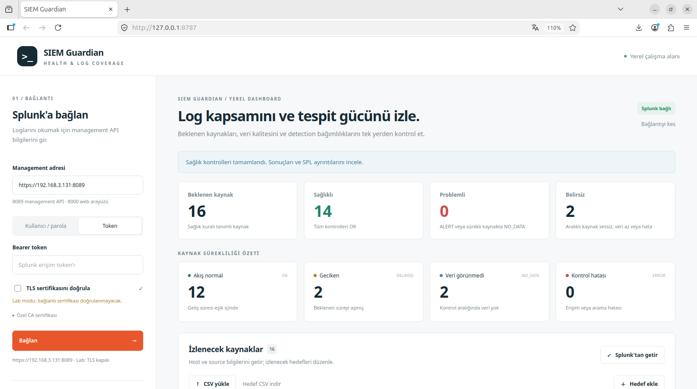

# SIEM Guardian

**SIEM Guardian, Splunk alertlerinin ihtiyaç duyduğu logların gelip gelmediğini kontrol eden yerel bir Python aracıdır.**

Bir alertin Splunk'ta tanımlı ve etkin olması, o alertin çalışması için gereken
logların hâlâ geldiği anlamına gelmez. SIEM Guardian giriş yapan kullanıcıya ait
alertleri okur, SPL içindeki açık log bağımlılıklarını çıkarır ve bu logları
seçilen zaman aralığında doğrular.

Örneğin bir PowerShell alerti Sysmon Event ID 1 veya PowerShell 4104 verisine
bağlıysa ve bu veri artık gelmiyorsa araç ilgili alerti riskli gösterir.



> Görsel, aracın önceki arayüzünden bir lab görüntüsüdür. Güncel arayüz alertlerin ihtiyaç duyduğu logların sağlığına odaklanır.

## Ne yapar?

1. Splunk Management API'ye salt okunur olarak bağlanır.
2. Giriş yapan kullanıcıyı `/services/authentication/current-context` ile bulur.
3. Yalnız bu kullanıcıya ait, etkin ve zamanlanmış alertleri getirir.
4. Alert SPL'lerinden sabit `index`, `host`, `sourcetype`, `source`,
   `EventCode` ve `EventID` değerlerini çıkarır.
5. Her benzersiz log bağımlılığını seçilen aralıkta `_indextime` üzerinden
   kontrol eder.
6. Alert bazında sağlık sonucu, olay sayısı, son log geliş zamanı ve kullanılan
   kontrol SPL'ini gösterir.
7. Sonuçları CSV olarak dışarı aktarır.

Araç başka kullanıcıların, Splunk'ın veya kurulu uygulamaların alertlerini
listelemez. Kullanıcı adıyla giriş yapıldığında o kullanıcının; token ile giriş
yapıldığında token sahibinin alertleri değerlendirilir.

## Durumlar

| Durum | Anlamı |
| --- | --- |
| `COVERED` | Alertin çıkarılabilen bütün log bağımlılıklarında veri görüldü. |
| `DEGRADED` | Bazı gerekli loglar geliyor, bazıları gelmiyor veya doğrulanamadı. |
| `BLIND` | Alertin açık log bağımlılıklarının hiçbirinde veri görülmedi. |
| `UNKNOWN` | SPL'den güvenilir bir log kaynağı çıkarılamadı. |
| `ERROR` | Splunk araması, erişim veya sonuç işleme hatası oluştu. |

`BLIND`, kaynağın kesin olarak durduğunu tek başına kanıtlamaz. Düşük log hacmi,
kapalı sistemler ve seçilen kontrol aralığı sonucu etkileyebilir.

## Gereksinimler

- Python 3.10 veya üzeri
- Splunk Enterprise Management API erişimi
- Alertleri ve ilgili indexleri okuyabilen bir Splunk hesabı veya token
- `requests` ve `python-dotenv`

Splunk Web genellikle `8000`, Management API ise `8089` portunu kullanır. Bu
araçta `https://SPLUNK_IP:8089` biçimindeki management adresi kullanılmalıdır.

## Ubuntu kurulumu

```bash
sudo apt update
sudo apt install -y git python3 python3-venv python3-pip

git clone https://github.com/efekanacar/siem-guardian.git
cd siem-guardian

/usr/bin/python3 -m venv .venv
source .venv/bin/activate
python -m pip install --upgrade pip
python -m pip install -r requirements.txt
```

Testleri çalıştırın:

```bash
python -m unittest discover -s tests -v
```

Arayüzü başlatın:

```bash
python webapp.py
```

Tarayıcıdan açın:

```text
http://127.0.0.1:8787
```

Port kullanımdaysa:

```bash
python webapp.py --port 8788
```

## Kullanım

1. **Management adresi** alanına `https://SPLUNK_IP:8089` yazın.
2. Alertleri oluşturan Splunk kullanıcısının kullanıcı adı/parolasını veya bu
   kullanıcıya ait Bearer token'ı girin.
3. Geçerli sertifikanız varsa TLS doğrulamasını açık bırakın. Self-signed lab
   sertifikasında doğrulamayı bilinçli olarak kapatabilirsiniz.
4. **Bağlan** düğmesine basın.
5. Kontrol aralığını dakika olarak seçin. Varsayılan `1440`, son 24 saattir.
6. **Logları kontrol et** düğmesine basın.
7. Her alertin durumunu ve izlediği logları inceleyin.
8. Gerektiğinde **Alert SPL ve kontrol sorguları** bölümünü açın.
9. **Alert CSV indir** ile raporu alın.

Sistemler sürekli açık değilse daha uzun bir aralık kullanabilirsiniz:

| Süre | Dakika |
| --- | ---: |
| 24 saat | `1440` |
| 3 gün | `4320` |
| 7 gün | `10080` |

## Araç alert bağımlılığını nasıl bulur?

Örnek alert SPL'i:

```spl
index="windows" sourcetype="XmlWinEventLog:Security" EventCode=4688
```

Araç bu sorgudan aşağıdaki bağımlılığı çıkarır:

```text
index=windows
sourcetype=XmlWinEventLog:Security
Event ID=4688
```

Sonra ilgili olayların seçilen aralıkta Splunk'a gerçekten ulaşıp ulaşmadığını
kontrol eder. Geliş zamanı `_time` yerine `_indextime` ile ölçülür. Böylece bugün
indekslenen eski bir olay yeni olay gibi yorumlanmaz.

Aynı log bağımlılığı birden fazla alert tarafından kullanılıyorsa Splunk sorgusu
bir kez çalıştırılır ve sonuç ilgili alertlerde yeniden kullanılır.

## SPL sınırları

Araç yalnız sorguda açıkça görülen sabit kaynak değerlerini güvenle çıkarır.
Aşağıdaki yapıların içindeki kaynakları tahmin etmez:

- SPL makroları
- lookup dosyaları
- `tstats` ve veri modelleri
- wildcard içeren kaynak seçimleri
- çalışma anında değişen token değerleri

Bu alertler `UNKNOWN` veya uyarılı sonuçla gösterilir. Araç çözümleyemediği bir
alerti yanlışlıkla sağlıklı kabul etmez. Ayrıntı bölümünde özgün alert SPL'i her
zaman görüntülenebilir.

## Beklediğiniz alert sayısı görünmüyorsa

Splunk Search ekranında şu sorguyu çalıştırın:

```spl
| rest /servicesNS/-/-/saved/searches
| search disabled=0 is_scheduled=1 alert_type!="none"
| stats count values(title) by eai:acl.owner
```

Beklediğiniz alertler hangi `eai:acl.owner` altında görünüyorsa SIEM Guardian'a
o kullanıcı veya o kullanıcıya ait token ile bağlanın. Başka kullanıcıya ya da
`nobody` sahibine aktarılmış alertler bilinçli olarak listeye alınmaz.

## Güvenlik

- Splunk üzerinde yalnız GET ve salt okunur arama işlemleri yapılır.
- Alert, index, input veya forwarder ayarları değiştirilmez.
- Arama tamamlanmadan sonuç alınmaz.
- HTTP ve Splunk arama zaman aşımı vardır.
- Parola ve token raporlara veya tarayıcı yerel depolamasına yazılmaz.
- Arayüz varsayılan olarak yalnız `127.0.0.1` üzerinde dinler.
- TLS doğrulaması varsayılan olarak açıktır.
- `ERROR` sonuçları `NO_DATA` gibi gösterilmez.

## Proje yapısı

```text
webapp.py                    Yerel web arayüzünü başlatır
continuity/alerts.py         Alert SPL bağımlılıklarını çıkarır ve değerlendirir
continuity/splunk.py         Splunk REST API ve arama işlerini yönetir
continuity/web.py            Yerel HTTP API ve oturum yönetimi
continuity/static/           HTML, CSS ve JavaScript arayüzü
tests/test_alerts.py         Alert filtreleme ve sağlık analiz testleri
tests/test_web.py            Web API ve arayüz akış testleri
siem-guardian.png            Arayüz görüntüsü
```

## Test

```bash
python -m unittest discover -s tests -v
```

Testler; kullanıcıya ait alert filtrelemesini, zamanlanmamış alertlerin
elenmesini, Event ID ayrıştırmasını, `_indextime` sorgularını, durum
değerlendirmesini, CSV güvenliğini ve web API akışını kapsar.

Bu proje gerçek Splunk ortamınızda kendi alertleriniz ve rol yetkilerinizle
doğrulanmalıdır. Depoda gerçek kimlik bilgisi veya gerçek hedef verisi bulunmaz.
